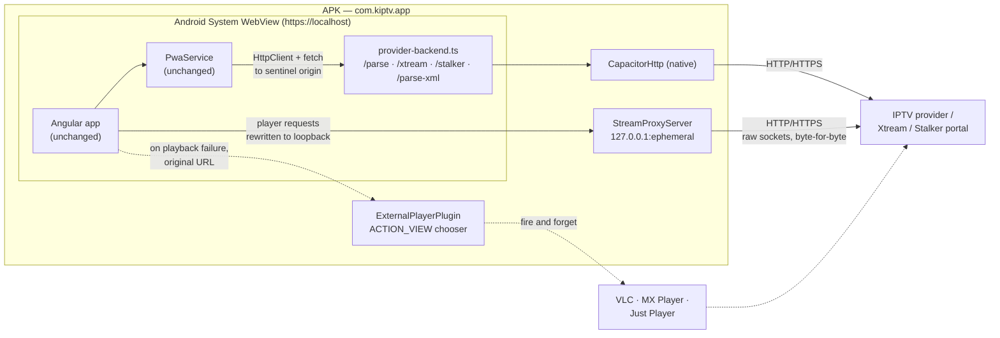

# K-IPTV for Android

An Android build of **K-IPTV**, a rebranded fork of
[IPTVnator](https://github.com/4gray/iptvnator), produced by wrapping the
existing Angular application in [Capacitor](https://capacitorjs.com/). It is the
same UI and the same code as the PWA — playlists, Xtream Codes portals, Stalker
portals, favourites, EPG and the video player are all the upstream
implementations.

The name and icon are our own, as [upstream's trademark notice](./TRADEMARK.md)
requires of a redistributed fork; the MIT licence and copyright notice are
retained unchanged.

The result is a normal installable APK: `com.kiptv.app`, min SDK 23
(Android 6), target SDK 35 (Android 15), with both a phone/tablet launcher
entry and an Android TV (leanback) one.

---

## How it works

The desktop app runs its provider logic in an Electron main process; the PWA
runs it in a small Node service (`apps/web-backend`) that the browser calls to
escape CORS. An installed Android app has neither, so this build re-implements
those provider routes **inside the app** and sends the outbound requests
through Capacitor's native HTTP client, which is not bound by the browser's
same-origin policy.



Key points:

- **`PwaService` is used unmodified.** `environment.android.ts` points
  `BACKEND_URL` at a sentinel origin (`https://provider-backend.iptvnator.invalid`).
  An HTTP interceptor and a narrow `fetch` patch recognise that origin and
  answer it locally. Any other origin is left alone, so pointing the app at a
  real self-hosted IPTVnator server still works.
- **Media never crosses the JavaScript bridge.** `CapacitorHttp` is
  deliberately *not* enabled globally in `capacitor.config.ts`. Enabling it
  patches `fetch` and `XMLHttpRequest` for the whole app, which would push
  every HLS segment through the bridge as base64. Media instead goes through a
  native loopback socket proxy (below), which streams bytes without ever
  entering JavaScript.
- **Cleartext HTTP is allowed.** Most IPTV providers, and nearly every
  self-hosted playlist on a home LAN, are HTTP-only.

### Stream proxy

Desktop Chrome is forgiving about how a media response is labelled. The
Android System WebView is not: a stream served as `application/octet-stream`,
or one that bounces through an `http` → `https` redirect, is frequently
rejected before a decoder is ever chosen — surfacing in the app as the generic
`UNKNOWN_PLAYBACK_ERROR`. IPTV providers do both of these things routinely.

`StreamProxyServer` is a small HTTP server bound to `127.0.0.1` on an
ephemeral port, started by `StreamProxyPlugin` at app launch. The web layer
awaits the port in an app initializer, then rewrites outbound media URLs to
it.

| Concern | Behaviour |
| --- | --- |
| Request shape | `GET /s?u=<base64url>` — base64url (unpadded) sidesteps every query-encoding pitfall in IPTV URLs full of `&` and `?` |
| Content type | `application/octet-stream`, `binary/octet-stream`, `text/plain`, `text/html`, `application/force-download` and empty are treated as useless and re-derived from the URL extension |
| Redirects | Followed manually, up to 5 hops, because `HttpURLConnection` refuses to cross `http` ↔ `https` — which providers do constantly |
| HLS | `.m3u8` bodies are rewritten: plain lines are resolved against the manifest URL and re-proxied, and `URI="…"` attributes on `EXT-X-KEY` / `EXT-X-MAP` / `EXT-X-MEDIA` are rewritten too |
| Seeking | `Range`, `If-Range`, `If-Modified-Since` and `If-None-Match` are forwarded; `Content-Length`, `Content-Range`, `Last-Modified`, `ETag` and `Accept-Ranges: bytes` come back |
| CORS | Permissive headers plus `OPTIONS` preflight, so cross-origin subtitle and key fetches stop failing |
| User agent | Overridden with a desktop Chrome string; some providers reject unfamiliar agents |

On the web side, `stream-proxy.ts` patches four shared choke points —
`HTMLMediaElement.prototype.src`, `HTMLSourceElement.prototype.src`,
`XMLHttpRequest.prototype.open` and `fetch` — so all four player engines
(video.js, ArtPlayer, plain `<video>`, Shaka) are covered without editing any
upstream player code. Only `GET` is rewritten. The app origin, the sentinel
backend origin and loopback hosts are excluded, the last of those preventing
already-rewritten manifest URLs from being proxied twice. If the proxy fails
to start, the patches are skipped and playback is attempted directly, so the
failure is never fatal.

### Runtime detection gates everything — get it right first

`isAndroidNativeRuntime()` in `android-runtime.ts` is the switch for every
native path: the stream proxy, the external-player launcher, the Video.js tech
overrides, the platform diagnostics and `initializeAndroidPlatform()`. It was
written as:

```ts
return capacitor.isNativePlatform === true && platform === 'android';
```

`Capacitor.isNativePlatform` is a **method** (`() => boolean`) in Capacitor 3
and later, so that reads a function object and compares it to `true` — always
false. Every native path quietly disabled itself on real hardware.

This failed almost silently, which is what made it expensive. The provider
backend bridge is deliberately *not* gated on this check, so playlists, Xtream
and Stalker calls all worked and the app looked healthy; only playback was
broken, which sent the investigation toward codecs and MIME types for several
builds. The giveaway was the `platform` block being absent from a diagnostic
report that was built to always emit it on Android.

`android-runtime.spec.ts` now pins the method form, the legacy boolean form,
the web platform, iOS, a missing bridge and a partial bridge. When a native
feature appears to do nothing on device, check this function before anything
else.

### Forcing Video.js to demux HLS

Android's WebView answers `canPlayType('application/vnd.apple.mpegurl')` with
`"maybe"`. videojs-http-streaming reads that as "the platform handles this
better than I would" and declines to attach, so the manifest goes straight to
the `<video>` element — which cannot actually play it. The result is
`MEDIA_ERR_SRC_NOT_SUPPORTED` (code 4) reported as the generic
`UNKNOWN_PLAYBACK_ERROR`.

The tell is the *absence* of evidence: a diagnostic reading
`stage=unknown · type=unknown · code=4` on an `.m3u8` carries no manifest
stage and no failed request, because VHS was never in the pipeline at all. A
stream that genuinely cannot be played fails further in, with VHS evidence
attached.

`player-tech.ts` registers `html5.vhs.overrideNative: true` (plus
`nativeAudioTracks: false` / `nativeVideoTracks: false`, since an overridden
tech and the native track lists disagree about track state). It goes through
the same register-from-the-platform pattern as the external launcher, in
`libs/playback/util/src/lib/player-tech-overrides.ts`, because this must not
apply on Safari — there native HLS genuinely is better than the MSE path and
has to keep winning.

### Edge-to-edge and the missing settings button

Anything targeting SDK 35 gets edge-to-edge enforced on Android 15, so the
WebView is laid out *behind* the status and navigation bars. The workspace
shell's phone layout puts a 52 px icon rail in its top grid row, and the
settings gear is pinned to the end of that rail — so the entire row, and with
it the only route into settings, vanished under the status bar.

`MainActivity.applySystemBarInsets()` pads the content view by the
system-bar + display-cutout insets. A `ViewCompat` listener is used rather
than `fitsSystemWindows` (ignored once a window opts into edge-to-edge) or the
StatusBar plugin's `setOverlaysWebView` (a no-op under the enforced
behaviour). Fullscreen video needs no special case: hiding the bars collapses
the insets to zero, which removes the padding on its own.

### Fullscreen without the Fullscreen API

Tapping fullscreen used to produce a full-screen picture with no controls on
it: play/pause, the seek bar and every other button were unreachable, wherever
you tapped.

Capacitor's `BridgeWebChromeClient.onShowCustomView` answers immediately with
`callback.onCustomViewHidden()` and never attaches the view. Chromium
therefore tears down the view that would have hosted the fullscreen DOM, while
the video itself stays composited full-screen natively. The controls were
still in the document and still reacting to taps — nothing of them was ever
painted.

Replacing the chrome client is not an option: its constructor registers
activity-result launchers, and registering those twice crashes at startup.
Instead `FullscreenStrategy` makes "fill the screen" pluggable. The web and
Electron builds keep the standard Fullscreen API; the Android build registers
a strategy that never leaves the document, promoting the player surface to a
fixed, full-viewport overlay and hiding the system bars.

Two details matter:

- Any ancestor with `transform`, `filter`, `backdrop-filter`, `perspective`,
  `contain` or `will-change` becomes the containing block for a
  `position: fixed` descendant, which would pin the "fullscreen" surface
  inside the page layout. The ancestor chain is neutralised on enter and
  restored on exit.
- The hardware back button leaves fullscreen before it is treated as
  navigation, via `exitAndroidFullscreen()`.

Because the strategy is captured when a player surface is constructed, it is
registered during bootstrap in `platform.providers.android.ts`, before Angular
renders.

### Seeing what the native layer actually did

None of the above is visible from the failure screen, so a diagnostic report
could not distinguish "the proxy never bound" from "the proxy bound and the
stream failed anyway" — which point at opposite causes. The report now carries
a `platform` block:

```json
"platform": {
  "shell": "capacitor",
  "streamProxy": "active",
  "streamProxyPort": 41234,
  "upstream": "403 text/html"
}
```

`streamProxy` is `unsupported` off Android, then `starting` → `active` or
`failed`. The report is an explicit allowlist that must never leak a stream
URL, so `platform-diagnostics.ts` sanitizes rather than trusts its provider:
only short primitives survive and anything containing `://` is dropped. The
loopback port is published, the proxy URL is not. The key is absent entirely on
web and Electron, where nothing registers a provider.

`upstream` is what the *provider* answered for the most recent stream request —
the status and bare content type, such as `403 text/html`, or an exception name
like `SocketTimeoutException` when the request never completed. A media element
collapses every one of these into the same "format is not supported" error, so
without it a rejected request is indistinguishable from undecodable media. The
two call for opposite fixes: a `200 video/mp4` that still fails is a codec the
device cannot decode, while `403 text/html` or `401` means the provider refused
the request and no player — not even VLC — will play it.

`StreamProxyServer` records the outcome and notifies the web layer only when it
*changes*, so an HLS session costs one bridge message instead of one per
segment. The URL is never part of the message.

### External player fallback

The proxy fixes streams the WebView *could* have played but rejected on
labelling or transport grounds. It cannot help with a stream the device simply
has no decoder for — HEVC/H.265 in an MP4 container being the common case.
For those, the playback error screen now offers **Open in another app**, which
hands the stream to VLC, MX Player, Just Player or anything else that accepts
a video `VIEW` intent.

Upstream already has an external-player subsystem — `ExternalPlaybackRecovery`,
`supportsManagedExternalPlayers`, `ACTION_OPEN_MPV` / `ACTION_OPEN_VLC` — and it
was deliberately **not** reused:

- `supportsManagedExternalPlayers` is `['openInMpv', 'openInVlc'].every(hasElectronMethod)`.
  Satisfying it means shimming `window.electronAPI`, which makes `isElectron`
  true and cascades into the SQLite storage path, window controls, the remote
  control server and playlist refresh. Far too much blast radius for one button.
- Its state machine models an *observable* player session
  (launching → opened → playing → closed) with a 10 s launch timeout. An Android
  `startActivity` is fire-and-forget: nothing reports back, so every launch would
  age out into `error`.

So there is a separate, deliberately smaller contract in
`libs/playback/util/src/lib/external-launch.ts`. It returns `null` on web and
Electron, so the button only ever renders on Android.

| Concern | Decision |
| --- | --- |
| MIME type | `video/*`, not `application/vnd.apple.mpegurl` — VLC, MX Player and Just Player all declare `video/*`, and several declare nothing HLS-specific |
| Package visibility | A `<queries>` block in the manifest is **load-bearing**: without it `queryIntentActivities` returns empty on Android 11+ and the button would never appear |
| Availability | Starts optimistic (`true`) and is corrected by an async probe — hiding a working escape route is worse than showing one explanatory message |
| URL passed | The **original** stream URL, not the proxied one; the external app does its own fetching |
| Semantics | Fire-and-forget. Success means the chooser opened, not that playback started |

Two i18n keys were added — `PLAYBACK_DIAGNOSTICS.ACTION_OPEN_EXTERNAL` and
`PLAYBACK_DIAGNOSTICS.EXTERNAL_NO_PLAYER`. They carry English text in all 21
locales and still need translating.

### What is not included

Electron-only features are out of scope, exactly as they are for the PWA:
*managed* MPV/VLC playback with a supervised session, playlist file downloads
to disk, local XMLTV file parsing, and the desktop remote-control server.
Upstream documents the PWA as a reduced feature set for the same reason. The
external player fallback above is a one-way intent handoff, not a managed
session.

---

## Files added for Android

| Path | Purpose |
| --- | --- |
| `capacitor.config.ts` | Capacitor project config |
| `apps/web/src/environments/environment.android.ts` | Sentinel `BACKEND_URL` |
| `apps/web/src/environments/platform.providers.ts` | No-op; the hook point for every non-Android build |
| `apps/web/src/environments/platform.providers.android.ts` | Registers the interceptor and the platform initializer |
| `apps/web/src/app/android/provider-backend.ts` | The web backend's provider routes, in-app |
| `apps/web/src/app/android/provider-backend-bridge.ts` | HTTP interceptor + `fetch` patch |
| `apps/web/src/app/android/native-http.ts` | Outbound HTTP over `CapacitorHttp` |
| `apps/web/src/app/android/android-platform.ts` | Back button, status bar, splash |
| `apps/web/src/app/android/fullscreen-strategy.ts` | In-document fullscreen, system bars and orientation |
| `apps/web/src/app/android/android-runtime.ts` | Native-runtime detection |
| `apps/web/src/app/android/stream-proxy.ts` | Starts the native proxy and rewrites media URLs to it |
| `apps/web/src/app/android/external-player.ts` | Registers the Android external-player launcher |
| `apps/web/src/app/android/player-tech.ts` | Registers the VHS `overrideNative` tech options |
| `apps/web/src/app/android/platform-diagnostics.ts` | Publishes proxy state into the diagnostic report |
| `libs/playback/util/src/lib/external-launch.ts` | Platform-agnostic launcher contract; `null` off Android |
| `libs/playback/util/src/lib/player-tech-overrides.ts` | Platform-agnostic Video.js tech overrides; no-op off Android |
| `libs/playback/util/src/lib/platform-diagnostics.ts` | Sanitized platform facts for the report; absent off Android |
| `libs/ui/playback/src/lib/player-controls/fullscreen-strategy.ts` | Pluggable fullscreen; the Fullscreen API everywhere but Android |
| `apps/web/src/types/epg-parser.d.ts` | Types for the untyped `epg-parser` |
| `tools/android/generate-launcher-icons.py` | Redraws every launcher icon, including the themed-icon layer |
| `android/` | Generated native project, with the edits listed below |

Native edits on top of the generated project:

- `AndroidManifest.xml` — cleartext traffic, network security config, leanback
  launcher category, `fullUser` orientation, picture-in-picture, large heap,
  `ACCESS_NETWORK_STATE`, `WAKE_LOCK`, and the `<queries>` block that keeps
  installed video players visible on Android 11+.
- `res/xml/network_security_config.xml` — permits cleartext and trusts
  user-installed CAs (home reverse proxies).
- `MainActivity.java` — `FLAG_KEEP_SCREEN_ON`, so a channel playing untouched
  does not dim the screen; `applySystemBarInsets()` for the Android 15
  edge-to-edge problem above; plus `registerPlugin(StreamProxyPlugin.class)`
  and `registerPlugin(ExternalPlayerPlugin.class)`. Both registrations must
  stay **before** `super.onCreate(...)`; Capacitor builds its plugin table
  during bridge construction and anything registered afterwards is invisible
  to the WebView.
- Launcher icons — a flat-screen TV carrying a play glyph, which reads as an
  IPTV app at launcher size where a bare play triangle does not. Regenerate
  with `python tools/android/generate-launcher-icons.py`; it writes the legacy
  and round rasters, the adaptive foreground and the Android 13 `monochrome`
  layer for all five density buckets. `drawable/ic_launcher_background.xml` is
  the gradient behind the adaptive foreground — the TV is white, so that
  background has to stay dark enough to keep it legible.
- `StreamProxyServer.java` / `StreamProxyPlugin.java` — the loopback media
  proxy described above, and the bridge that exposes `start()` → `{port,
  baseUrl}` to JavaScript. Written in Java rather than Kotlin because the
  `app` module has no Kotlin plugin applied.
- `ExternalPlayerPlugin.java` — `isAvailable()` and `open()`, firing an
  `ACTION_VIEW` chooser at whatever video players are installed.

Eight shared files were touched:

- `apps/web/src/app/app.config.ts` — spreads `platformProviders`.
- `apps/web/src/app/services/runtime-config.ts` — `shouldEnableServiceWorker()`
  now also returns `false` under Capacitor.
- `apps/web/project.json` — adds the `android` build configuration and allows
  `epg-parser` as a CommonJS dependency.
- `libs/playback/util/src/index.ts` — exports the launcher contract, the tech
  overrides and the platform diagnostics.
- `libs/ui/playback/.../playback-diagnostic-report.util.ts` — adds the
  sanitized `platform` block to the copyable report.
- `libs/ui/playback/.../playback-diagnostic-panel.component.html` — offers the
  external player above the built-in player cards rather than below them,
  since a codec the device cannot decode defeats every built-in engine.
- `libs/ui/playback/.../vjs-player-setup.ts` — merges any registered tech
  overrides into the Video.js constructor options.
- `libs/ui/playback/.../playback-diagnostic-panel.component.{ts,html}` — the
  **Open in another app** button, rendered only when a launcher is registered.

---

## Prerequisites

| Tool | Version used | Notes |
| --- | --- | --- |
| Node.js | 22.23.4 | The repo requires `^22.23.4 \|\| ^24.22.1` |
| pnpm | 10.33.0 | `corepack enable` or install globally |
| JDK | 21 (Temurin/Microsoft OpenJDK) | 17 also satisfies AGP 8.7 |
| Android SDK | Platform 35 + Build-Tools 35.0.0 + platform-tools | Command-line tools are enough; Android Studio is optional |

Set the usual environment variables:

```powershell
$env:JAVA_HOME      = "C:\Program Files\Microsoft\jdk-21.0.13.21-hotspot"
$env:ANDROID_HOME   = "<path-to>\android-sdk"
$env:ANDROID_SDK_ROOT = $env:ANDROID_HOME
```

`android/local.properties` must point at the SDK:

```properties
sdk.dir=C\:\\Users\\you\\AppData\\Local\\Android\\Sdk
```

---

## Building

```bash
pnpm install

# Angular bundle only  ->  dist/apps/web
pnpm run build:android

# bundle + copy into the native project
pnpm run android:sync

# bundle + sync + debug APK
pnpm run android:apk
```

The APK lands at:

```
android/app/build/outputs/apk/debug/app-debug.apk
```

Install it with `adb install -r android/app/build/outputs/apk/debug/app-debug.apk`,
or copy it to the device and open it with "install from unknown sources"
enabled.

To work on the native side in Android Studio: `pnpm run android:open`.

### Release builds

`pnpm run android:apk:release` produces an **unsigned** release APK. To ship
one, create a keystore and add a `signingConfigs` block to
`android/app/build.gradle`:

```gradle
signingConfigs {
    release {
        storeFile file(System.getenv("IPTVNATOR_KEYSTORE"))
        storePassword System.getenv("IPTVNATOR_KEYSTORE_PASSWORD")
        keyAlias System.getenv("IPTVNATOR_KEY_ALIAS")
        keyPassword System.getenv("IPTVNATOR_KEY_PASSWORD")
    }
}
buildTypes {
    release {
        signingConfig signingConfigs.release
    }
}
```

---

## Environment notes

These are workarounds for the machine this port was built on, not upstream
requirements. Check whether they apply before copying them.

- **`node-linker=hoisted` in `.npmrc`.** pnpm's default symlinked
  `node_modules` was unusable here: the junctions had valid reparse data and
  valid targets but resolved to empty directories, so `tslib` and others could
  not be found. A flat `node_modules` avoids the issue. Related: renaming a
  directory that contains a pnpm `node_modules` breaks its absolute-path
  junctions — delete `node_modules` and reinstall after a rename.
- **`NX_SOCKET_DIR`.** Nx builds its plugin IPC socket paths from the
  workspace path and can exceed the OS limit. Set it to something short, e.g.
  `NX_SOCKET_DIR=D:\nxs` (create the directory first).
- **`pnpm.overrides` in `package.json`.** The registry mirror in use did not
  carry a handful of exact transitive versions. Each override pins the nearest
  available one. On a normal npmjs.org connection they can be removed.

---

## Verified

- `nx build web --configuration=android` — succeeds, `dist/apps/web` emitted
  with `<base href="/">` and no service worker.
- `gradlew assembleDebug` — `BUILD SUCCESSFUL`, 193 tasks.
- `nx test ui-playback` — 1661 passed, 2 failed. Both failures are in
  `player-controls/*.palette.spec.ts`, read `.scss` files straight off disk and
  compare against hard-coded forward-slash paths; they fail on Windows for that
  reason alone and are unrelated to any Android change.
- `app-debug.apk` — 12.1 MB, `com.kiptv.app`, label `K-IPTV`,
  minSdk 23 / targetSdk 35, phone and leanback launcher activities present,
  `StreamProxyServer`, `StreamProxyPlugin` and `ExternalPlayerPlugin` all
  present in `classes4.dex`, proxy and external-player client code present in
  the web bundle, `<queries>` compiled into the binary manifest with both the
  `video/*` and `https` intents.
- `apksigner verify` — valid v1 + v2 signatures, Android debug certificate.
- On-device: installs, launches, and the UI works. Provider API calls succeed
  through the in-app backend — playlists, Xtream categories and VOD detail
  pages all load.

Not yet verified on a device: **neither playback fix has been exercised at
runtime.** No device has been attached at any point, so the stream proxy's
Range seeking, HLS manifest rewriting and content-type correction are
reasoned-through but untested, and the external-player handoff has never
actually launched anything. The two fixes are deliberately complementary —
the proxy addresses streams the WebView mislabels or cannot transport, the
external player addresses codecs it cannot decode — so between them there is a
path forward whichever hypothesis turns out to be right, but which one is
actually at fault is still unknown.

To find out, attach the device and watch the log while reproducing:

```powershell
adb logcat -c
adb logcat | Select-String "chromium|StreamProxy|ExternalPlayer|Capacitor"
```

`StreamProxy` logs its bound port at startup and any upstream failure per
request; `ExternalPlayer` logs intent resolution. The debug APK is also
WebView-debuggable via `chrome://inspect`.
